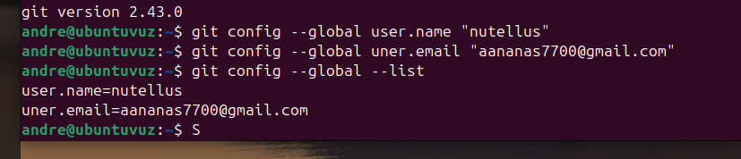
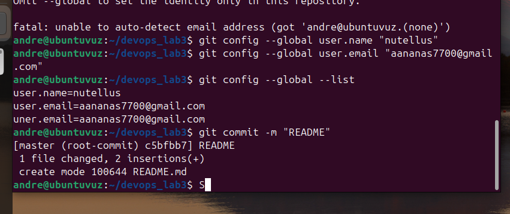
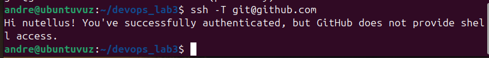
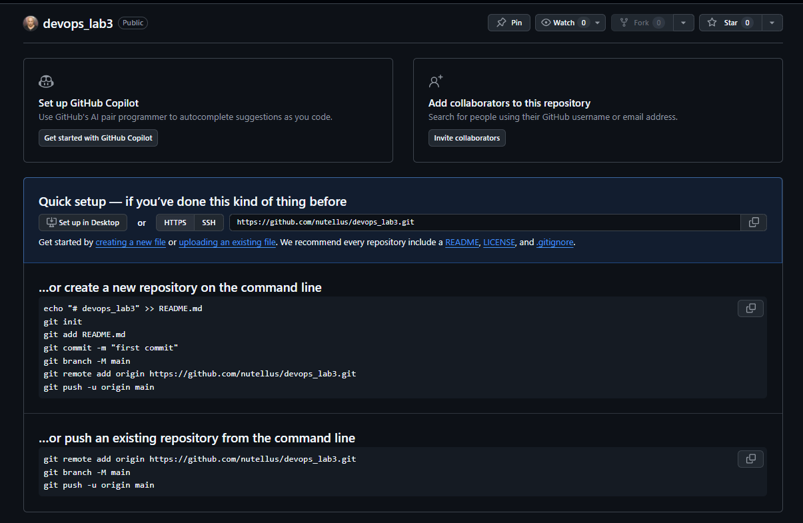
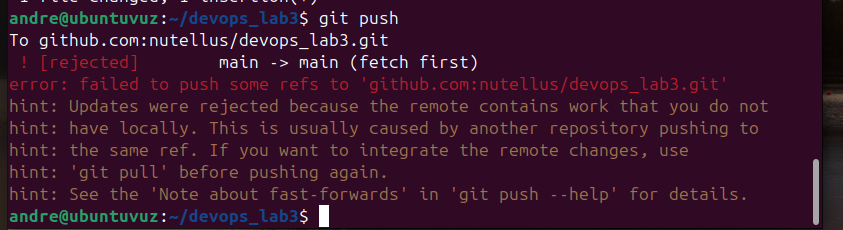
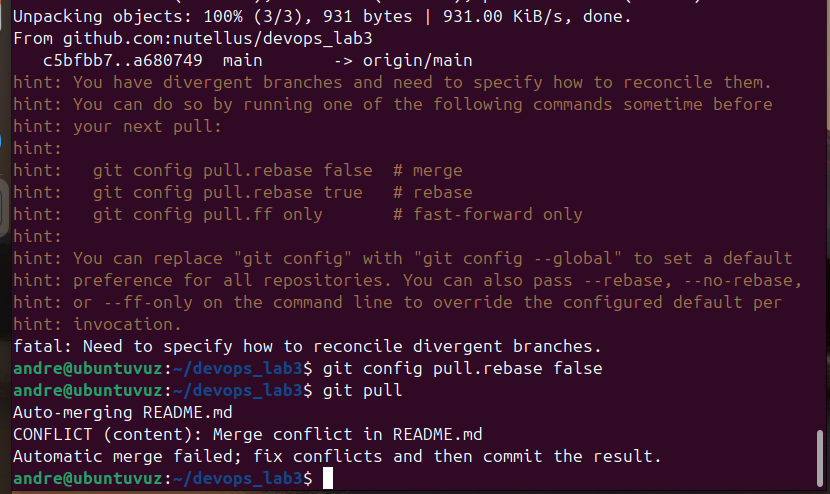
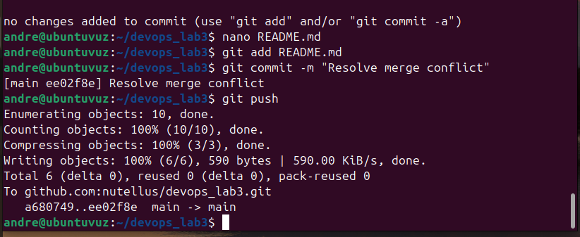
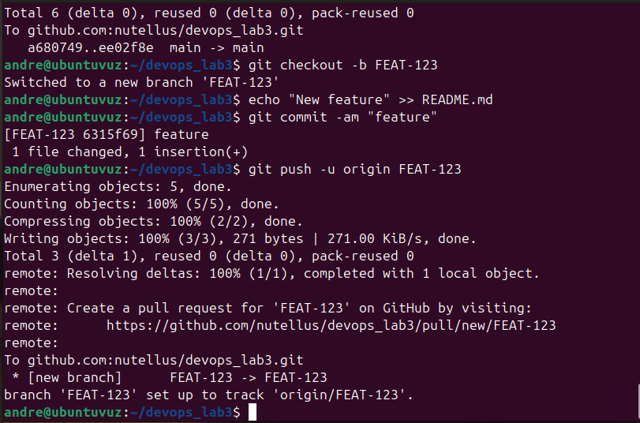

# Практическая работа № 3 — Git

**Дисциплина:** DevOps  
**Тема:** системы контроля версий на примере Git  
**Среда выполнения:** Ubuntu 24.04 (VirtualBox), терминал Linux, GitHub  
**Репозиторий:** [nutellus/devops_lab3](https://github.com/nutellus/devops_lab3)

## Цель работы

Освоить создание локального и удалённого Git-репозиториев, фиксацию изменений, взаимодействие с GitHub по SSH, команды `git add`, `git commit`, `git push`, `git pull`, а также разрешение конфликта слияния и работу с ветками.

## Используемое ПО

| Компонент | Описание |
|---|---|
| Виртуальная машина | Ubuntu в VirtualBox |
| Git | `2.43.0` |
| GitHub | `nutellus` |
| Локальный каталог | `/home/andre/devops_lab3` |
| Основная ветка | `main` |
| Учебная дополнительная ветка | `FEAT-123` |
| Доступ к GitHub | SSH (ключ Ed25519 создан внутри Ubuntu) |

## Ход работы

### 1. Настройка Git

Убедились, что Git установлен, и задали имя и электронную почту автора коммитов:

```bash
git --version
git config --global user.name "nutellus"
git config --global user.email "<адрес электронной почты>"
git config --global --list
```

В терминале подтверждена версия `git version 2.43.0`. После первоначальной ошибки определения автора настройки были уточнены, и коммит выполнен успешно.



### 2. Создание локального репозитория

Создали каталог лабораторной и инициализировали в нём репозиторий Git:

```bash
mkdir devops_lab3
cd devops_lab3
git init
nano README.md
```

В первоначальном `README.md` разместили простой учебный текст. Затем добавили файл в индекс Git и выполнили первый коммит:

```bash
git add README.md
git commit -m "README"
```

**Результат:** создан корневой коммит `c5bfb7` с сообщением `README`; один файл добавлен в репозиторий.



### 3. Настройка доступа к GitHub через SSH

В Ubuntu создали ключ Ed25519:

```bash
ssh-keygen -t ed25519 -C "<адрес электронной почты>"
```

Публичный ключ (`~/.ssh/id_ed25519.pub`) добавили в GitHub через **Settings → SSH and GPG keys**. Успешность авторизации проверили командой:

```bash
ssh -T git@github.com
```

GitHub ответил сообщением об успешной авторизации пользователя `nutellus`.



> В репозиторий **не помещаются приватные SSH-ключи**. GitHub используется как удалённый Git-сервер; терминал GitHub не предоставляет.

### 4. Создание удалённого репозитория и первый push

На сайте GitHub создали **пустой** репозиторий `devops_lab3`, не добавляя через интерфейс README, `.gitignore` или лицензию.



Связали локальный репозиторий с GitHub через SSH и отправили первый коммит:

```bash
git remote add origin git@github.com:nutellus/devops_lab3.git
git branch -M main
git push -u origin main
```

После обновления страницы GitHub файл `README.md` появился в удалённом репозитории. Это действие было проверено в ходе выполнения работы; отдельный скриншот самого первого успешного `push` не сохранился.

### 5. Создание конфликта изменений

Чтобы воспроизвести конфликт, изменили файл `README.md` **локально** и зафиксировали коммит:

```bash
echo "Hello, Local World!" >> README.md
git commit -am "local hello"
```

Затем через веб-интерфейс GitHub изменили тот же участок `README.md` другим текстом и сохранили отдельный коммит на сервере.

При попытке отправить локальную версию возникла ожидаемая ошибка:

```bash
git push
```

```text
! [rejected] main -> main (fetch first)
error: failed to push some refs
```



### 6. Разрешение конфликта через git pull

Сначала попытались получить изменения из GitHub:

```bash
git pull
```

Git предложил указать стратегию объединения расходящихся веток, поэтому настроили обычное слияние и повторили команду:

```bash
git config pull.rebase false
git pull
```

Получили сообщение о конфликте в файле `README.md`:

```text
CONFLICT (content): Merge conflict in README.md
Automatic merge failed; fix conflicts and then commit the result.
```



Открыли конфликтующий файл в текстовом редакторе, убрали служебные маркеры `<<<<<<<`, `=======`, `>>>>>>>` и оставили согласованный текст с локальными и удалёнными изменениями. Затем завершили слияние:

```bash
git add README.md
git commit -m "Resolve merge conflict"
git push
```

**Результат:** создан merge-коммит `ee02f8e` и успешно отправлен в ветку `main` на GitHub.



### 7. Создание и публикация отдельной ветки

В дополнительной части практики создали ветку `FEAT-123`, изменили `README.md` и отправили ветку в удалённый репозиторий:

```bash
git checkout -b FEAT-123
echo "New feature" >> README.md
git commit -am "feature"
git push -u origin FEAT-123
```

**Результат:** создан коммит `6315f69` и опубликована ветка `origin/FEAT-123`. Настроено отслеживание удалённой ветки.



### 8. Проверка состояния репозитория

Для демонстрации текущего состояния Git подходят команды:

```bash
cd ~/devops_lab3
git status
git remote -v
git branch -a
git log --oneline --graph --all --decorate
```

В ходе работы подтверждены успешная отправка изменений и публикация `FEAT-123`. **Отдельного скриншота финального объединения `FEAT-123` с `main` нет**, поэтому здесь оно не обозначено как подтверждённое.

При необходимости проверить или завершить это объединение можно отдельно (сначала убедившись в текущем состоянии веток):

```bash
git checkout main
git merge FEAT-123
git push
```

В задании также указана команда `git clone`. В доступных материалах нет подтверждения её отдельного выполнения; для демонстрации клонирования репозитория **в новую папку** можно использовать:

```bash
cd ~
git clone git@github.com:nutellus/devops_lab3.git devops_lab3_clone
git -C devops_lab3_clone status
```

Эти команды приведены для проверки, а не как уже зафиксированный результат.

## Итог

В ходе работы был создан локальный репозиторий, настроена SSH-аутентификация на GitHub, выполнена отправка коммитов в удалённый репозиторий, воспроизведён и устранён конфликт слияния, а также создана и опубликована дополнительная ветка `FEAT-123`. Результаты подтверждены скриншотами выполнения команд и интерфейса GitHub.

## Материалы

Все скриншоты расположены в каталоге [`screenshots/`](screenshots/). Они сделаны во время выполнения практики; изображения не являются имитацией терминала.
